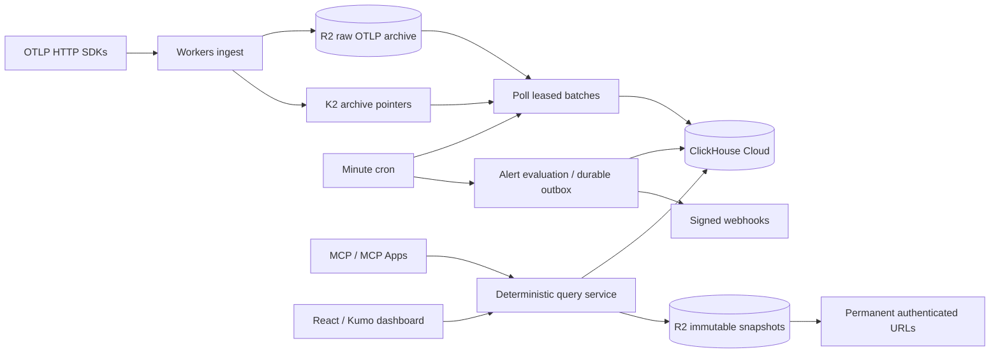

# mvp-o11y

An agent-first observability workbench on Cloudflare Workers. Send OTLP, query ClickHouse Cloud through MCP, save visual evidence, and send alerts to agents through webhooks.

React + Cloudflare Kumo provide a dashboard and the same visualizations inside MCP Apps. This repository is an initial single-workspace implementation, intended to run in your own Cloudflare and ClickHouse accounts.



## What works

- OTLP/HTTP traces, logs, and all five metric kinds, as JSON or protobuf, optionally gzip compressed. Requests are validated and archived before success. Maximum decoded request size: 8 MiB.
- K2 producer binding and scheduled HTTP pull consumption, acknowledgment after ClickHouse insertion, stable deduplication tokens and durable ingestion receipts.
- ClickStack's pinned ClickHouse schema, with expiration TTLs removed. Raw payloads and saved query results have no application expiration in R2.
- Arbitrary read-only ClickHouse SQL across REST, MCP, visualizations, and alerts: CTEs, joins, aggregates, window functions, and metrics. Typed query parameters bind values without SQL interpolation. Five editable examples provide starting points.
- Immutable saved results with the exact SQL, bound parameters, columns, rows, chart column mappings, timestamps, and SHA-256 digest. `/s/:id` reads the saved object without querying ClickHouse again.
- Streamable HTTP MCP at `/mcp`, including tools for querying, saving and retrieving visualizations, and managing alerts. MCP Apps share the React renderer with the dashboard.
- SQL threshold alerts with a selected numeric output column, fixed evaluation windows, cooldowns, durable webhook outbox, HMAC signatures, and retry handling.
- Bearer authentication on ingestion, API, and MCP endpoints. Permanent view URLs retain workspace authentication; possession of a URL alone does not grant access.

## Local development

Requires Node.js 24 and npm. Docker is optional for ClickHouse integration testing.

```sh
npm ci
cp .dev.vars.example .dev.vars
npm run build:web
npx wrangler d1 migrations apply mvp-o11y --local
npm run dev
```

Open `http://localhost:8787`. The dashboard has an explicitly labeled preview mode with sample telemetry. Enter the local `API_TOKEN` in Settings for live requests. Tokens are held in browser session storage. ClickHouse and K2 require configured services; local preview does not simulate successful ingestion.

For frontend iteration, use `npm run dev:web` alongside Wrangler on port 8787. `npm run check` runs TypeScript, unit/integration tests, the two frontend builds, and a Worker dry run.

## Provision and deploy

1. Create a ClickHouse Cloud service running **26.2 or newer**. Apply `clickhouse/schema.sql` to the database selected by `CLICKHOUSE_DATABASE`. See [schema provenance and compatibility](docs/schema.md). Use a separate insertion account for ingestion. Create the dedicated SELECT-only `o11y_query` account using `clickhouse/query-user.sql`, selecting the telemetry database with `clickhouse-client --database ...` and supplying `--param_query_password`. This account has database-enforced read-only and resource constraints. See [SQL setup and examples](docs/sql.md). Arbitrary SQL requires its credentials and never falls back to ingestion credentials.
2. Create an R2 bucket and a D1 database:

   ```sh
   npx wrangler r2 bucket create mvp-o11y-archive
   npx wrangler d1 create mvp-o11y
   ```

   Copy the D1 ID into `wrangler.jsonc`, then run `npx wrangler d1 migrations apply mvp-o11y --remote`.

3. Create a K2 stream and an earliest-starting subscription. Add the producer binding and consumer IDs described in [K2 setup](docs/k2.md). K2 is a public beta and requires an eligible Cloudflare account. Its retention is finite; R2 is the permanent archive.
4. Set `PUBLIC_BASE_URL` to your final Worker/custom-domain HTTPS origin. Set `CLICKHOUSE_DATABASE`, `CLICKHOUSE_USER`, and comma-separated `WEBHOOK_ALLOWED_HOSTS` in `wrangler.jsonc`. Allowlist the exact hostnames of the webhook destinations you intend to use.
5. Configure secrets using `npx wrangler secret put NAME` for each of:

   ```text
   API_TOKEN
   INGEST_TOKEN
   CLICKHOUSE_URL
   CLICKHOUSE_PASSWORD
   CLICKHOUSE_QUERY_USER
   CLICKHOUSE_QUERY_PASSWORD
   K2_STREAM_ID
   K2_SUBSCRIPTION_ID
   K2_API_TOKEN
   WEBHOOK_SECRET
   ```

   Use separate strong random API, ingestion, and signing secrets. `K2_API_TOKEN` needs K2 Consume permission. `INGEST_TOKEN` is optional; when omitted ingestion uses `API_TOKEN`.

6. Run `npm run deploy`. Cron runs every minute. Check Worker logs for failed ingestion or alert polls and verify an actual SDK export before routing production telemetry.

No application code expires raw telemetry or snapshots. Keep R2 lifecycle expiration disabled for `otlp/` and `snapshots/`, and do not add ClickHouse TTLs. Storage availability still depends on keeping the accounts, resources, and billing active. Deleting the bucket or tables deletes the data.

## Send telemetry

Standard SDK configuration:

```sh
export OTEL_EXPORTER_OTLP_ENDPOINT=https://your-worker.example
export OTEL_EXPORTER_OTLP_PROTOCOL=http/protobuf
export OTEL_EXPORTER_OTLP_HEADERS="Authorization=Bearer YOUR_INGEST_TOKEN"
```

Endpoints are `POST /v1/traces`, `/v1/logs`, and `/v1/metrics`. OTLP/gRPC is not supported by this Worker. SDKs should retry retryable failures. The HTTP success response means the request is archived and queued, not that it is immediately queryable. With minute polling, freshness is typically one to two minutes and can increase under backlog.

## Query, save, and connect an agent

See [MCP and webhook usage](docs/mcp.md). Configure a remote MCP client with the URL `https://your-worker.example/mcp` and the `Authorization: Bearer …` header. This initial version uses a workspace bearer token; OAuth discovery and multi-user authorization are not implemented. Clients that require OAuth need an authentication gateway or a future OAuth provider.

Example REST request body for `POST /api/query` (the same shape is accepted by the MCP `run_query` tool):

```json
{
  "sql": "SELECT ServiceName AS service, count() AS requests, quantile(0.95)(Duration / 1000000) AS p95_ms FROM otel_traces WHERE Timestamp >= parseDateTime64BestEffort({from:String}, 9, 'UTC') AND Timestamp < parseDateTime64BestEffort({to:String}, 9, 'UTC') GROUP BY service ORDER BY requests DESC, service",
  "parameters": {
    "from": "2026-10-01T00:00:00Z",
    "to": "2026-10-01T01:00:00Z"
  },
  "limit": 1000
}
```

To save evidence, `POST /api/snapshots` with `{"title":"Service latency","visualization":"table","query":{...}}`. Charts accept optional `mapping` to select output columns. Saving executes the supplied SQL once and archives its returned result, source, and chart configuration. Opening that snapshot never reruns the query. Arbitrary SQL can use relative time or nondeterministic functions, so repeatable executions require explicit bound times and `ORDER BY`; late-arriving data can still change later results. The saved snapshot remains fixed.

MCP clients can call `describe_schema` to discover columns and types before composing SQL. The five preset query objects remain supported for existing clients and snapshots. SQL has no preset-enforced time-window requirement. See [SQL visualizations](docs/sql.md) and [SQL alerts](docs/sql-alerts.md) for complete examples.

## Current scope and operating limits

This is a project foundation, not a managed multi-tenant service. It has no organization accounts, OAuth login, alert recovery notifications, or generalized dashboard layout builder. All ingested metric tables can be queried with SQL; additional metric starter examples can be added as useful. Request/error presets count root spans, so sampling and instrumented span boundaries affect their interpretation.

The K2 consumer guarantees at-least-once processing. Stable tokens and D1 receipts reduce duplicates, but cannot make ClickHouse and D1 an atomic transaction. See [delivery semantics](docs/k2.md). Invalid archived records block their leased batch until investigated. Polling is deliberately bounded; scale consumer concurrency and backfill/replay tooling before high-volume use. R2 keeps the raw records available for recovery, but this version does not run automatic archive backfills after K2 retention expires.

Saved result sets are capped at 10,000 rows and 10 MB. Truncation is recorded and shown. Read-only SQL has database-enforced execution, memory, scan, and output budgets; these limits do not impose data retention. The optional legacy presets retain their 31-day window cap; SQL can query any retained time range within the resource budgets. Alerts skip truncated results. Webhooks are delivered at least once, so receivers must deduplicate event IDs.

## Source map

- `src/worker/` — ingestion, K2 consumer, ClickHouse client, queries, snapshots, alerts, MCP, and HTTP routing.
- `src/web/` — React/Kumo dashboard, chart renderer, and MCP App.
- `clickhouse/schema.sql`, `migrations/` — ClickHouse and D1 schema.
- `proto/` — pinned Apache-2.0 OpenTelemetry protocol definitions and provenance.
- `test/` — protocol normalization, failure/retry behavior, deterministic queries, and immutable results.
